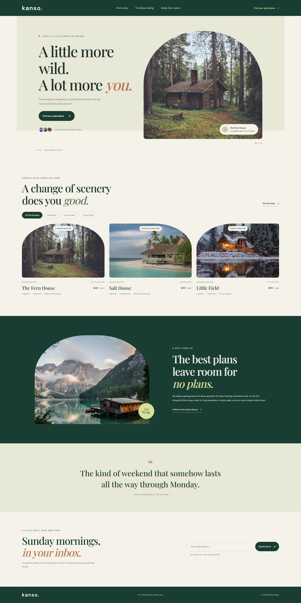

# Kanso — Find Your Still Place

Kanso is a responsive, nature-inspired landing page for a fictional collection of considered weekend stays. The visual direction combines botanical greens, warm cream, soft clay accents, editorial typography, and organic image shapes to create a calm, premium travel experience.

The page is built with plain HTML, CSS, and JavaScript. It has no framework, build pipeline, package dependencies, or backend requirements, making it easy to open locally, customize, and deploy as a static site.

## Preview

The included screenshot shows the complete desktop page from the header through the footer.



## Page Overview

### Header and hero

- Dark forest-green header with the Kanso wordmark
- Desktop navigation for stays, the brand story, and the newsletter
- Bold editorial headline, short introductory copy, primary call to action, and social proof
- Large arched woodland cabin image with a stay caption and image-position indicator
- Responsive mobile menu with an accessible expanded state

### Featured stays

- Three curated stays: The Fern House, Salt House, and Little Field
- Location, distance, nightly price, guest capacity, bedroom count, and stay style
- Category filters for all stays, woodland, coast, and countryside
- Subtle card and image hover effects
- Organic, individually rounded image compositions

### Brand story

A contrasting forest-green section introduces the Kanso philosophy and pairs a lake image with a concise brand manifesto.

### Guest quote

A warm cream testimonial section provides social proof and a visual pause before the signup area.

### Newsletter

A simple email signup section validates the address using the browser's native email validation and provides accessible on-page confirmation feedback.

### Footer

A compact footer repeats the wordmark and includes a short brand line and copyright.

## Features

- Fully responsive layouts for desktop, tablet, and mobile
- Separate `index.html`, `styles.css`, and `script.js` files
- Semantic HTML sections and accessible labels
- Entrance animations with staggered delays
- Soft image zoom and button hover interactions
- Interactive stay-category filtering
- Accessible mobile navigation
- Newsletter email validation and live confirmation message
- `prefers-reduced-motion` support for people who prefer less animation
- Lazy loading for below-the-fold photography
- Local, remote asset, and deployment-friendly structure

## Technology

This project uses:

- HTML5 for structure and semantic content
- CSS3 for layout, typography, responsive behavior, and animation
- Vanilla JavaScript for filtering and navigation
- Unsplash-hosted photography
- Google Fonts for DM Sans and Playfair Display

There is no need to install JavaScript packages or run a compilation step.

## Project Structure

```text
kanso/
├── index.html       # Page structure and content
├── styles.css       # Visual system, responsive styles, and animations
├── script.js        # Filters, mobile navigation, and signup behavior
├── screenshot.png   # Full-page desktop screenshot
└── README.md        # Project documentation
```

## Run Locally

### Option 1: Open directly

Open `index.html` in a modern browser.

Some browsers and workflows handle external fonts or images more reliably through a local server, so the server option below is recommended.

### Option 2: Use Python

From the project directory, run:

```powershell
python -m http.server 8000
```

Then open:

<http://localhost:8000>

Stop the server by pressing `Ctrl+C` in the terminal.

### Option 3: Use another static server

You can also serve the directory with tools such as VS Code Live Server, Node's `npx serve`, or any standard static-hosting provider.

## Customization

### Change the brand name

The visible name appears in:

- The page title and meta description in `index.html`
- Both header and footer wordmarks
- The stay and story descriptions
- The README and screenshot filename context

Search for `Kanso` in `index.html` and replace it consistently when creating a new brand.

### Change colors

The main palette is defined near the top of `styles.css` through CSS custom properties:

```css
:root {
  --paper: #f4f2e9;
  --cream: #e8e8d7;
  --ink: #20342b;
  --forest: #193d32;
  --moss: #60755a;
  --sage: #c4cfb0;
  --lime: #d9de99;
  --clay: #b87454;
  --muted: #737c70;
  --line: #dedfd1;
}
```

Changing these values updates the shared palette throughout the page.

### Update stay content

Each featured stay is an `<article class="stay-card">` in `index.html`. Update the image, category, location, travel time, title, price, and description inside the matching card.

The category filters depend on the card's `data-category` value:

- `woods`
- `coast`
- `countryside`
- `all` is handled automatically by JavaScript

### Replace photography

The images are remote Unsplash URLs. Replace the `src` values in `index.html` with local assets or hosted image URLs.

For a production site, it is a good practice to download or license the final images, optimize them to appropriate dimensions, and provide local copies for more predictable loading and availability.

### Connect the newsletter

The current form is a front-end demonstration. Submitting a valid email shows a success message and clears the field, but it does not send data to a server.

To collect real subscribers, connect the form to your preferred email provider or replace the submit handler in `script.js` with an API request that submits the email and handles success and error states.

## Responsive Behavior

The layout is designed with several breakpoints:

- Wide desktop: full navigation and three-column stay grid
- Medium screens: tighter spacing and smaller headlines
- Mobile: stacked hero content, one-column stays, compact navigation, full-width newsletter controls

At small widths, the navigation button reveals the three main page links and updates `aria-expanded` for assistive technology.

## Accessibility and Motion

The page includes:

- Semantic `header`, `main`, `section`, `nav`, and `footer` elements
- A single primary page heading
- Section and navigation labels
- Form labels
- Image alternative text
- Visible control focus behavior
- `aria-live` feedback for newsletter submission
- `aria-pressed` state for stay filters
- Reduced-motion rules that effectively remove entrance and transition movement

As with every landing page, a final production pass should include keyboard testing, color-contrast checks, and assistive-technology testing.

## Browser and Form Behavior

The JavaScript provides:

- Stay filtering by toggling `.is-hidden` on cards
- Active-state and `aria-pressed` updates for filter buttons
- Mobile-menu open and close behavior
- Automatic menu closing after a mobile navigation link is selected
- Browser-native email validation on newsletter submission
- An accessible confirmation message after successful demo submission

The newsletter is intentionally non-functional as a delivery service until a backend or third-party mailing provider is connected.

## Assets and External Services

The page loads:

- DM Sans and Playfair Display from Google Fonts
- Photography from Unsplash
- The avatar images and landscape photography by remote URL

An internet connection is required for the externally hosted typography and photography to appear exactly as designed. For fully self-contained deployment, replace those resources with local copies and update the corresponding URLs.

Unsplash terms and the license conditions of the selected photographs should be reviewed before commercial use.

## Validation Performed

During development, the page was checked for:

- Desktop layout and full-page rendering
- Mobile layout and horizontal overflow
- Mobile menu expansion
- Stay filtering
- Newsletter submission feedback
- Loading state for page images
- CSS patch whitespace and formatting
